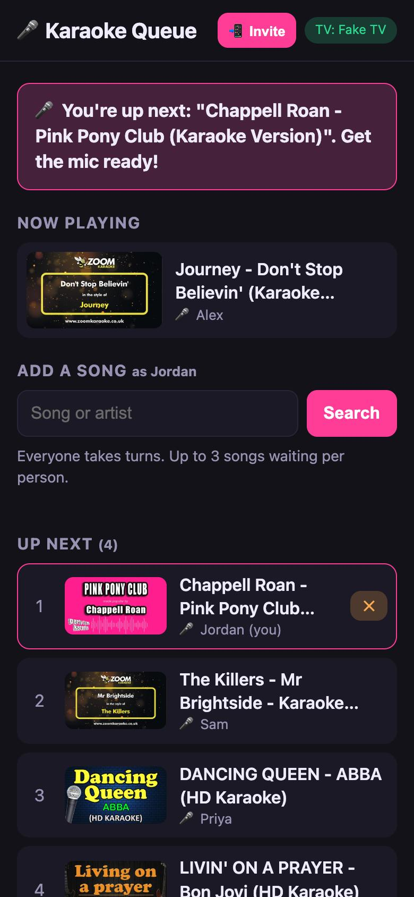
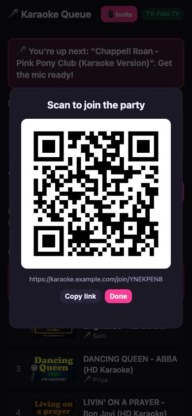
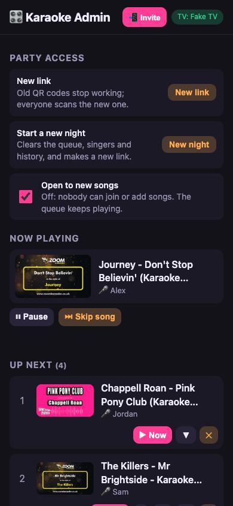
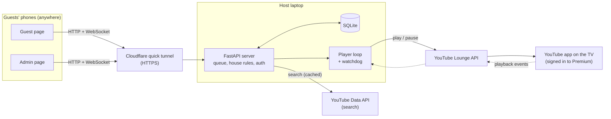

# 🎤 Karaoke Queue

**A party-proof karaoke queue for the YouTube app on your TV.** Guests scan a QR
code and request songs from their phones, everyone takes fair turns, admins run
the show, and the TV keeps its YouTube Premium status, so no ads mid-chorus.


<table>
  <tr>
    <td align="center"></td>
    <td align="center"></td>
    <td align="center"></td>
  </tr>
  <tr>
    <td align="center"><b>Guests</b><br>Search, request, see your place in line</td>
    <td align="center"><b>Invite</b><br>Anyone in the party can share the QR code</td>
    <td align="center"><b>Admins</b><br>Reorder, skip, pause, block, new link</td>
  </tr>
</table>

<sub>Screenshots use the built-in fake TV and demo data.</sub>

---

## The problem

YouTube's own shared queue ("Link with TV code") is the obvious way to do karaoke
at home, and it has two problems:

1. **One non-Premium guest brings the ads back.** As soon as anyone without
   Premium joins the TV session, the TV plays ads for everyone, even if the host pays.
2. **Nobody is in charge.** Every guest can skip, reorder and queue ten songs in a
   row. There's no admin, no fairness and no way to keep strangers out.

## The idea

**Guests never connect to the TV. Only the server does.**

Guests talk to a small web app. The server is the TV's only remote: it keeps the
real queue and sends one song at a time to the YouTube app over the same protocol
that phone remotes use. With no guest accounts in the TV session, a TV signed in
to Premium stays ad-free. Before writing the app, I proved this with a spike that
played monetized videos and listened for ad events: none came.



## Features

**For guests**
- Scan the QR code, type a name, then search YouTube or paste a link. A
  **🎤 Karaoke / 📝 Lyrics** toggle picks backing tracks (the default) or
  original-vocal lyric videos.
- See the live queue and your place in line. Remove your own songs.
- **"You're up next" / "You're on!"** banner, tab title and vibration, with
  optional system notifications.
- **📲 Invite** pops up the party's QR code to share with friends.

**For admins** (shared PIN)
- Skip, pause and resume, **▶ Play now**, move up/down/top, and remove.
- Block or remove singers. Idle singers are tucked under "Show older".
- **House rules:** fair turns on/off and a per-person waiting limit.
- **Party access:** a new link (old QR codes stop working at once), open/closed
  to new songs, and **New night** to wipe the slate.
- Pair the TV from the admin page with its "Link with TV code".

**Fair turns.** Each person's 1st waiting song is in round 1, their 2nd in round 2,
and so on. The song playing now counts as its singer's turn, and songs already sung
never count against anyone. A new song goes at the end of its round:

| Queue before | Jordan joins and adds a song |
|---|---|
| ▶ Alex · 1. Sam · 2. Priya · 3. Alex | ▶ Alex · 1. Sam · 2. Priya · **3. Jordan** · 4. Alex |

Newcomers wait at most about one round, and nobody sings twice in a row while
others are waiting. The insertion reads the queue as it actually is, so an admin's
manual reordering is never undone.

## Engineering highlights

- **Risk first.** Phase 0 was a ~190-line spike to answer the one question that
  could sink the project: does a Premium TV stay ad-free when only a script is
  linked? The answer decided the architecture.
- **A public link without a public free-for-all.** Moving from Wi-Fi-only to
  "anyone with the QR code" brought a real threat model:

  | Threat | Mitigation |
  |---|---|
  | Strangers find the URL | Every guest route needs the party link's secret code (cookie); others see "Scan the QR code" |
  | The link spreads too far | **New link** rotates the code and disconnects stale WebSockets immediately |
  | Spam joins, searches and requests | Sliding-window rate limits per client, plus a waiting cap per singer |
  | Dodging limits by faking an IP | Forwarded IP headers are trusted only from the local tunnel process |
  | Burning the YouTube API quota (~100 searches/day) | 6-hour search cache; pasted links use a keyless lookup |
  | Guessing the admin PIN | Per-client lockout **and** a global lockout (defeats IP rotation); constant-time comparisons |
  | Cookie theft | HttpOnly, SameSite, and Secure whenever the request came in over HTTPS |

- **Reliability for a live event.**
  - The TV connection reconnects on its own and refreshes expired tokens.
  - YouTube's autoplay is turned off so the TV never wanders off between songs.
  - A **watchdog** skips videos that never start (removed, region-blocked or
    age-restricted), but doesn't blame the song if the TV dropped offline.
  - A song interrupted by a crash goes back to the front of the queue.
  - Older databases are upgraded in place, so no party history is lost.
- **Live updates** over a WebSocket hub: every change in the queue, TV status or
  notices reaches every phone at once.
- **Tested without a TV.** A `FakeScreen` implements the same interface as the real
  TV, so the 69 tests cover the player, fairness rules, auth, rate limits and
  migrations deterministically. Each phase was also checked end to end in a real
  browser, through a real Cloudflare tunnel, and on a real TV.

## Tech stack

| Layer | Choice | Why |
|---|---|---|
| Server | Python, FastAPI, Uvicorn | Async fits a long-lived TV connection plus WebSockets |
| TV control | [`pyytlounge`](https://github.com/FabioGNR/pyytlounge) (YouTube Lounge API) | The protocol behind "Link with TV code" remotes |
| Storage | SQLite | One house, one queue; nothing to run |
| Frontend | Plain HTML, CSS, JS, WebSocket | Phones just open a link: no install, no build step |
| Public access | Cloudflare quick tunnel | HTTPS link from a laptop, no router changes, home IP stays private |
| QR codes | `segno` | Pure Python; terminal and SVG output |
| Tests | pytest, pytest-asyncio, Starlette TestClient | |

## Getting started

You need Python 3.11+, a TV with the YouTube app signed in to Premium, and a
[YouTube Data API key](https://developers.google.com/youtube/v3/getting-started)
(free) for song search.

```bash
git clone https://github.com/Baotluong/karaoke-queue.git
cd karaoke-queue
python3 -m venv .venv
.venv/bin/pip install -r requirements-dev.txt
brew install cloudflared            # for links that work off your Wi-Fi
```

Create a `.env` file:

```bash
YT_API_KEY=your-youtube-data-api-key
KQ_ADMIN_PIN=pick-6-or-more-characters
```

Start a party:

```bash
.venv/bin/python party.py           # or: party.py --local for Wi-Fi only
```

`party.py` starts the server and a Cloudflare tunnel, then prints a QR code. Open
the admin link it prints, log in with your PIN, and pair the TV under **TV**
(YouTube app → Settings → Link with TV code). Then show the QR code to your guests.

### Configuration

| Variable | Default | Meaning |
|---|---|---|
| `YT_API_KEY` | none | YouTube Data API key. Without it, guests paste links instead of searching. |
| `KQ_ADMIN_PIN` | random each run (printed) | PIN for `/admin`; use 6+ characters on a public link |
| `KQ_PUBLIC_URL` | set by `party.py` | Base address used in the QR code |
| `KQ_DB` | `karaoke.db` | SQLite file |
| `KQ_FAKE_TV` | off | Use a pretend TV (development) |
| `KQ_FAKE_SONG_SECONDS` | `20` | Song length on the fake TV |

## Development

```bash
.venv/bin/pytest                    # 69 tests, no TV or network needed

# Run with a pretend TV whose songs last 15 seconds
KQ_FAKE_TV=1 KQ_FAKE_SONG_SECONDS=15 .venv/bin/python party.py --local
```

```
app/
  main.py      FastAPI routes, WebSocket hub, party gate, rate limits
  store.py     SQLite: singers, queue, fair-turn insertion, settings, migrations
  player.py    Sends the next song to the TV, watchdog, notices
  tv.py        Screen interface: LoungeScreen (real TV) and FakeScreen
  search.py    YouTube search with a cache, link parsing, keyless lookup
  admin.py     PIN auth with per-client and global lockouts
  limits.py    Sliding-window rate limiter, real client IP behind the tunnel
  static/      Guest, admin and gate pages (vanilla JS)
party.py       Starts server + tunnel and prints the QR code
spike/         Phase 0: the ad-free experiment
tests/         69 tests
```

## Build log

Built in small phases, each tested on a real TV before moving on:

| Phase | What shipped |
|---|---|
| 0 | Spike: proved a Premium TV stays ad-free when only the server is linked |
| 1 | Web app: search, request, live queue, player loop |
| 2 | Admin PIN: skip, pause, reorder, remove, block |
| 3 | Fair turns, waiting limit, no duplicates, guests remove their own songs |
| 4 | Join from anywhere: Cloudflare tunnel, QR party link, rate limits, lockouts |
| 5 | Stuck-song watchdog, your-turn alerts, pair the TV from the admin page |
| + | Invite pop-up, singer cleanup, new night |

## Limitations

- The YouTube Lounge API is unofficial. It's what YouTube's own phone remotes use,
  but it could change without notice.
- Your-turn alerts need the page open. iPhones only allow web notifications for
  home-screen apps, and don't support vibration.
- The quick-tunnel address changes each time `party.py` starts, so print the QR
  code per party, not once.
- Not affiliated with or endorsed by YouTube or Google. It doesn't block ads; it
  just keeps your own Premium session to yourself.
